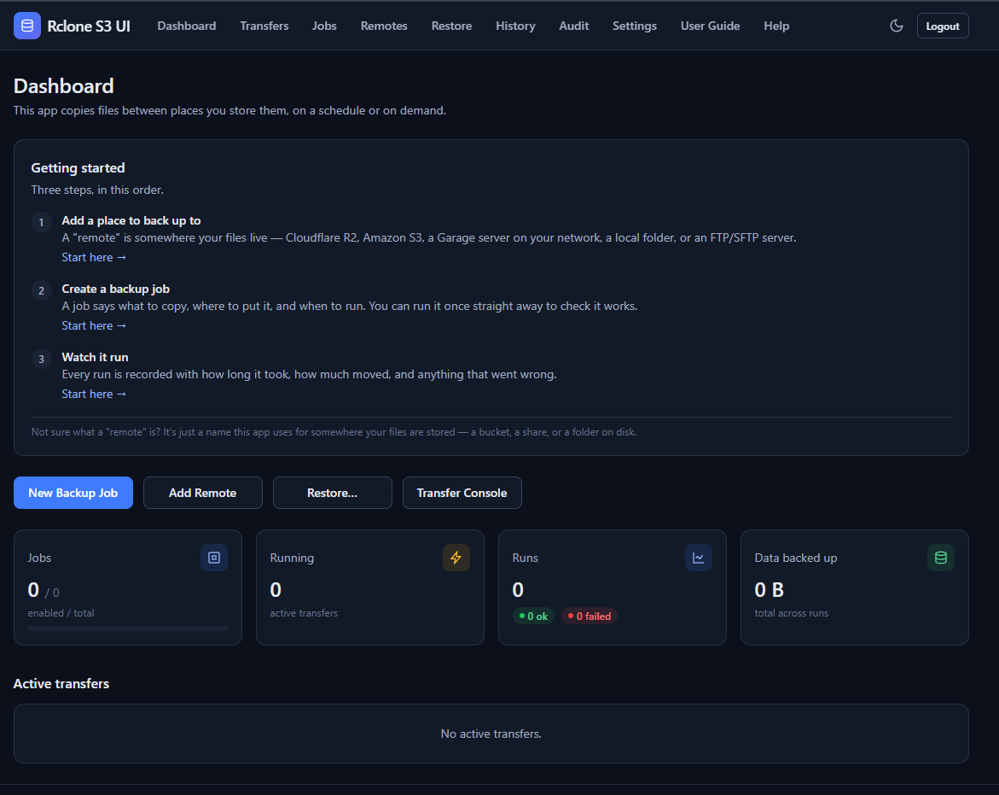
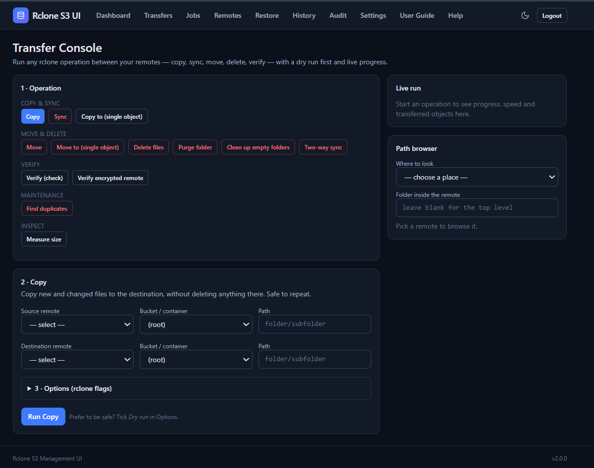
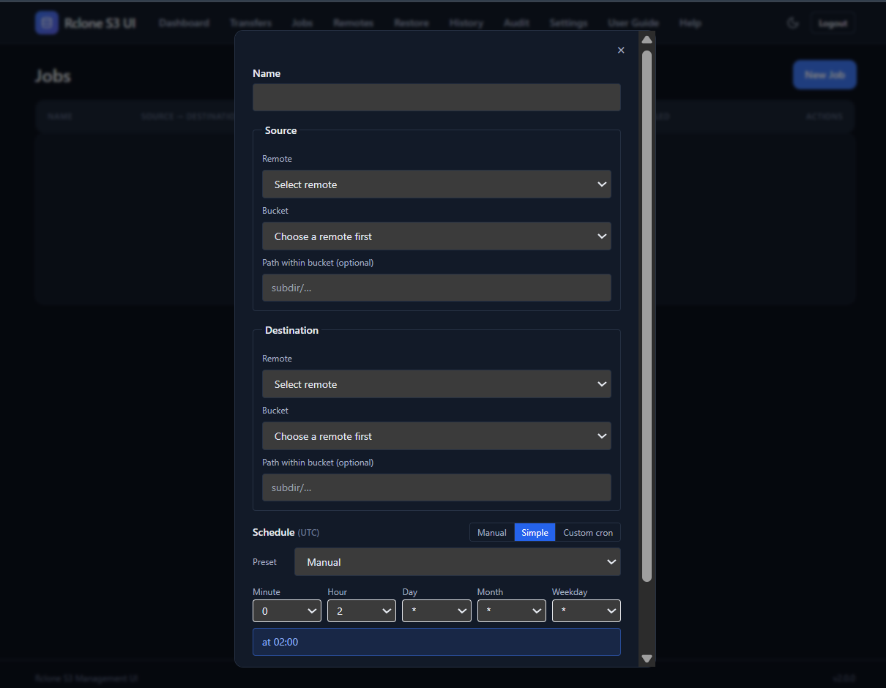
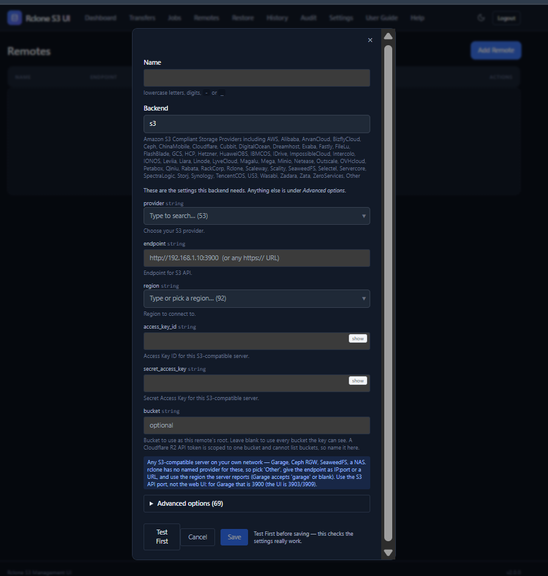
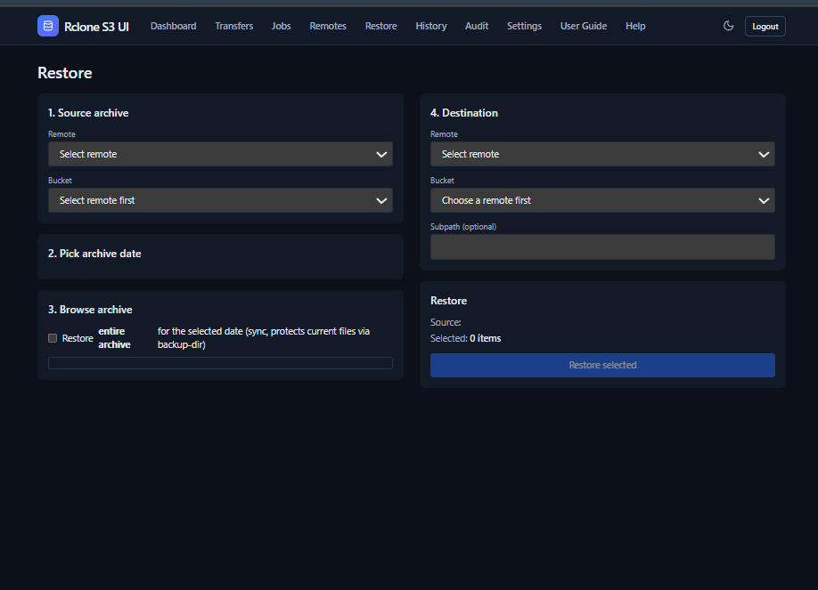

# Rclone S3 Management UI

A self-hosted web UI for operating `rclone` jobs across Garage, Cloudflare R2,
AWS S3, MinIO, and other rclone backends. Configure remotes once, then use the
dashboard to schedule cron jobs, move data between buckets, restore snapshots,
and review what happened.


## What it does

- Configure S3-compatible remotes with provider-aware options.
- Run scheduled or manual bucket-to-bucket backups.
- Copy, sync, move, delete, check, size, and other allow-listed rclone operations.
- Preview destructive work with dry runs and confirmation gates.
- Watch live progress, logs, errors, transfer sizes, and run status.
- Keep an audit/history trail for jobs, transfers, restores, and settings changes.
- Restore the latest state or a timestamped backup archive.
- Automate through the JSON API and monitor with `/health` and `/metrics`.
- Encrypt remote credentials and other secret backend options at rest.

The application discovers backend options from the rclone installation, so the
remote form is not limited to S3. S3-compatible providers such as Garage,
Cloudflare R2, AWS, MinIO, and Wasabi are the primary use case.

## Screenshots

### Dashboard



### Transfer Console



### Scheduled Jobs



### Remote Configuration



### Restore



## How backups work

A backup job syncs a source remote to a destination `latest/` path. Changed or
deleted destination files are placed in a timestamped archive using rclone's
`--backup-dir`. Retention cleanup removes old archive dates. The restore flow
can use the current `latest/` copy or reconstruct a historical point in time
from the archive deltas.

All application state is stored in the mounted `data/` directory:

- `orchestrator.db`: remotes, jobs, runs, audit records, and settings.
- `.encryption_key`: Fernet key for encrypted credentials.
- `.session_secret`: signing key for session cookies.
- `logs/`: per-run rclone logs.

Keep the database and encryption key together when backing up the application.

## Quick start with Docker

Requirements: Docker Engine and Docker Compose v2. Docker Desktop provides
both on Windows and macOS.

Clone the repository and enter its directory:

```text
git clone https://github.com/aqib169/Rclone-Ui-S3-management-tool.git
cd Rclone-Ui-S3-management-tool
```

Create the local environment file from the included template, then edit it and
replace the placeholder password with a long random value.

Linux/macOS (Bash or a similar shell):

```bash
cp .env.example .env
$EDITOR .env
```

Windows (PowerShell):

```powershell
Copy-Item .env.example .env
notepad .env
```

The `.env` file is ignored by Git. Start the application from any of these
shells:

```text
docker compose up -d --build
```

Open <http://localhost:8000>, sign in, and add your remotes. The Compose setup
mounts `./data`, runs with a read-only root filesystem, drops to a non-root app
user, and includes a healthcheck.

Do not expose the port directly to the internet without TLS and network access
controls. Compose intentionally refuses to start when `USERNAME` or `PASSWORD`
is missing, so credentials must be configured before deployment.

## First workflow

1. Open **Remotes** and add a Garage, Cloudflare R2, AWS S3, or other rclone remote.
2. Use **Test First** to verify the endpoint and credentials.
3. Create a **Job** with a source remote, destination remote, and optional cron expression.
4. Run it manually first, then enable the schedule.
5. Use **History** and the run detail view to inspect files, bytes, logs, and errors.
6. Use **Transfers** for one-off copy/sync work and **Restore** for archived data.

Cron schedules use UTC. Destructive operations require a dry run or explicit
confirmation, and conflicting writes to the same target are guarded.

## Configuration

Environment values are read at startup and can also be adjusted from the
Settings page where supported.

| Variable | Default | Purpose |
|---|---|---|
| `USERNAME` | required | UI and API username |
| `PASSWORD` | required | UI and API password |
| `DATA_DIR` | `/app/data` | Database, keys, and logs |
| `RCLONE_BIN` | `rclone` | rclone executable |
| `SELF_BACKUP_DEST` | empty | Optional destination for application self-backup |
| `RETAIN_DAYS` | `14` | Backup archive retention |
| `LOG_RETAIN_DAYS` | `30` | Run-log retention |
| `RCLONE_TRANSFERS` | `4` | Parallel rclone transfers |
| `STATS_INTERVAL` | `10` | Progress update interval in seconds |
| `RCLONE_CHECKSUM` | `true` | Compare files by checksum |

The scheduler is in-process and uses one instance per data directory. Missed
cron runs are not replayed after downtime.

## API and monitoring

The JSON API is available under `/api` and accepts HTTP Basic authentication.
It covers remotes, providers, jobs, transfers, runs, restores, history, and
settings. Useful endpoints include:

```text
GET  /health
GET  /metrics
GET  /api/providers
GET  /api/operations
POST /api/transfers/run
GET  /api/runs/{id}/progress
POST /api/runs/{id}/cancel
```

Example remote creation for Cloudflare R2:

```bash
curl -u "$USERNAME:$PASSWORD" \
  -X POST http://localhost:8000/api/remotes \
  -H 'Content-Type: application/json' \
  -d '{
    "name": "r2",
    "type": "s3",
    "provider": "Cloudflare",
    "endpoint": "https://<account-id>.r2.cloudflarestorage.com",
    "access_key": "<r2-access-key>",
    "secret_key": "<r2-secret-key>"
  }'
```

## Security notes

- Remote secrets are encrypted with Fernet before being stored in SQLite.
- rclone commands are launched without a shell.
- Remote options and exposed rclone flags are validated.
- Destructive operations have dry-run/confirmation safeguards.
- Session cookies are signed and HttpOnly; API clients can use Basic auth.
- The Docker image runs as a non-root user with a read-only root filesystem.
- `data/`, `.env`, and runtime artifacts must never be committed.

This is an infrastructure tool. Test restores and permissions with non-critical
data before trusting it with production buckets.

## Development

Runtime dependencies:

```bash
python -m venv .venv
python -m pip install -r requirements.txt -r requirements-dev.txt
```

The local runtime also needs `rclone` on `PATH` or `RCLONE_BIN` set.

Run the application locally on Linux/macOS:

```bash
DATA_DIR=/tmp/rclone-ui-data USERNAME=admin PASSWORD=devpass \
  python -m uvicorn app.main:app --host 127.0.0.1 --port 8000
```

PowerShell equivalent:

```powershell
$env:DATA_DIR = "$PWD\data-dev"
$env:USERNAME = "admin"
$env:PASSWORD = "replace-with-a-development-password"
python -m uvicorn app.main:app --host 127.0.0.1 --port 8000
```

Frontend tooling requires Node.js 20+:

```bash
npm ci
npm run build:css
npm run lint
```

Run tests:

```bash
python -m pytest tests -v
```

## Project layout

```text
app/
  routers/       HTTP pages and JSON API routes
  services/      backup, restore, transfer, retention, and locking logic
  templates/     Jinja/HTMX web interface
  auth.py        session and Basic authentication
  crypto.py      credential encryption
  database.py    SQLite setup, migrations, and instance lock
  providers.py   rclone backend catalogue
  operations.py  validated rclone operations and flags
  scheduler.py   cron jobs and housekeeping
tests/           unit, integration, browser-DOM, and lifecycle tests
```

## Contributing

Issues and pull requests are welcome. Keep changes focused, add or update
tests for behavior changes, and run the Python and frontend checks before
opening a pull request.

## License

MIT. See [LICENSE](LICENSE).
